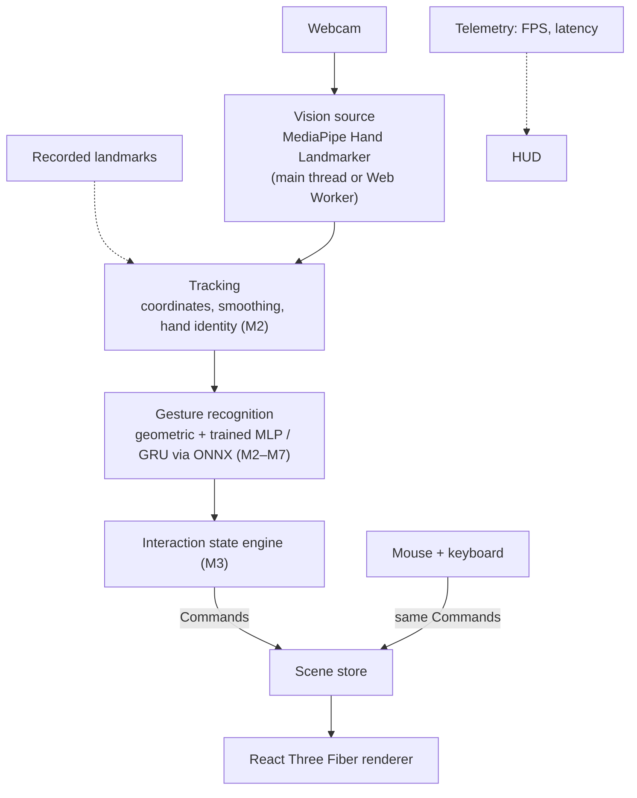

# Gestur3D

**A holographic 3D workspace you control with your hands through a webcam.** Grab, rotate and scale floating objects, draw in the air, and trigger effects with gestures. Hand tracking runs locally in the browser. The gesture classifiers are trained from scratch in PyTorch on a purpose-built landmark dataset and run in the browser via ONNX.

> **Status: Milestone 3 (advanced interactions) complete.** Grab with one hand, scale, turn and push objects with two, draw in the air, and use a radial menu by pointing, with mouse and keyboard as a full fallback. See the [roadmap](#roadmap).

## What works today

- **Landing page** with an interactive holographic hero (React Three Fiber, selective bloom)
- **Camera setup**: explains camera use before the browser asks, then shows a mirrored live preview with hand skeletons, detection FPS and latency, a camera picker, and a calibration checklist (hands, distance, lighting). It gives specific recovery steps when the camera is blocked, missing or busy.
- **Hand control**: pinch to grab an object, move your hand to carry it, and open your fingers to release. Works with either hand.
  - Cursors per hand (cyan right, violet left) show detected, hovering (with pinch progress), grabbing, released and lost states.
  - Accurate at any window size and with the side panels open: the hand maps onto the visible scene area, and picking uses the same camera projection as rendering.
  - One Euro smoothing (adjustable), a "reach" setting for how far you move, and a 300 ms grace that freezes held objects through brief tracking dropouts.
  - Detection runs on the main thread by default (measured faster than the Web Worker, which stays available as a setting). The tracking panel shows backend, detection rate, inference time and end-to-end latency, and can record landmarks (never video).
- **Two hands**: pinch an object with one hand and anywhere with the other, then spread to scale, turn to rotate, and move both hands toward or away from the camera to push or pull. Or hold the other hand open over the object to push and pull with one hand.
- **Radial menu**: point (index finger up) and hold still to open it at your hand, or press M. Add one of nine shapes, Draw, Color, Undo, Delete, or Clear drawings. Sectors are sticky, so small movements don't jump to a neighbor.
- **Air drawing**: turn on Draw (button, D or the menu) and pinch empty space to draw a glowing stroke, or drag with the mouse. Drawings are objects: select, move, scale, recolor, delete and undo them.
- **Workspace**: holographic lab environment with directly manipulable objects
  - Mouse: click to select, drag to move, Shift-drag to rotate, scroll to scale, drag empty space to orbit
  - Keyboard: Tab cycles objects, arrows move, Q/E/W/S rotate, +/− scale, Delete removes, Ctrl/⌘ Z undoes, M opens the menu, D toggles Draw, ? shows controls
  - HUD: measured render FPS and frame time, draw calls and triangles, current mode, Objects and Settings panels, and a draggable camera preview
- **Privacy**: the camera turns off when you leave setup or the workspace. No frames are stored or uploaded. Models and the wasm runtime are self-hosted.
- **Accessibility**: every action works without gestures, focus is never trapped, selection changes are announced, and reduced motion follows the OS setting with an in-app override.

## Architecture



Three rules keep it fast and testable (see [ADR-0002](docs/adr/0002-threading-and-render-loop.md), and [ADR-0003](docs/adr/0003-hand-pointer-pipeline.md) for the hand pipeline):

1. **Every input becomes a `Command`.** One pure reducer handles them all, so mouse, keyboard, gestures and replays share the same tested logic.
2. **No per-frame data in React state.** Landmarks and transforms live in refs and the render loop. React only sees throttled summaries.
3. **`src/core` is framework-free.** No React or Three.js (enforced by ESLint), so vision, tracking and interaction logic is unit-testable on its own.

Landmark conventions and normalization are defined once in [`shared/landmark-spec`](shared/landmark-spec/SPEC.md). Golden test vectors keep the browser and the Python training code in sync.

## Repository layout

```
web/                  Vite + React + TypeScript app
  src/core/           framework-free logic: vision (sources, worker, replay),
                      tracking (smoothing, pinch, hand tracks), interaction
                      (commands, reducer, hand mapping, hand engine)
  src/features/       landing, setup, workspace, camera, hands
  src/scene/          R3F canvas, environments, objects, shaders
  src/ui/             design system (glass components, tokens)
  src/stores/         Zustand stores: settings, scene, HUD layout
  e2e/                Playwright tests (run with a fake camera)
  scripts/            prepare-models: self-hosts MediaPipe assets
shared/landmark-spec/ landmark spec, reference normalization, golden vectors
ml/                   Python: dataset processing, training, evaluation (M5–M7)
docs/                 ADRs and benchmarks
```

## Getting started

Requirements: Node 22+, pnpm 10, and for `ml/`, [uv](https://docs.astral.sh/uv/).

```bash
pnpm install
pnpm dev            # downloads MediaPipe model files on first run, then starts Vite
```

Open `http://localhost:5173`. Camera access needs `localhost` or HTTPS. Desktop Chrome, Edge and Arc are the primary targets; Safari and Firefox are best-effort.

| Command                                      | What it does                                |
| -------------------------------------------- | ------------------------------------------- |
| `pnpm dev`                                   | Dev server                                  |
| `pnpm build` / `pnpm preview`                | Production build / serve it locally         |
| `pnpm typecheck` · `pnpm lint` · `pnpm test` | Static checks and unit tests (all packages) |
| `pnpm test:e2e`                              | Playwright end-to-end tests                 |
| `cd ml && uv sync && uv run pytest`          | Python checks                               |

## Testing

- **Unit (Vitest):** command reducer, keyboard mapping, camera error handling, calibration math, rate meters, settings, UI components, landmark normalization (property tests and golden vectors)
- **End-to-end (Playwright, fake camera):** landing → setup, the camera on/off flow and turning it off on navigation, keyboard control without focus traps, panels, settings persistence
- **Hand interaction (Playwright + scripted landmarks):** grab/move/release at four window sizes, panels open and hidden, both hands; tracking dropouts; swept pinches and idle hands never grab; two-hand scale, turn, depth and hand loss; opening and using the menu by pointing; drawing with hands and the mouse.
- **Measurements (Vitest):** cursor jitter and lag, and per-detection cost of drags, two-hand grabs and drawing Where the hand model is available (CI), a test also checks that live detection starts in the workspace.
- CI runs everything on every pull request.

Performance numbers are recorded in [docs/benchmarks.md](docs/benchmarks.md). Only measured values go there.

## Roadmap

Gestur3D is growing into three modes on one shared gesture and interaction engine: **Practice** (guided lessons), **Playground** (rebuild target figures, level by level) and **Workspace** (import, inspect and annotate 3D models). Practice is recommended but optional, and mouse controls stay available where they make sense.

| Milestone                         | Scope                                                                                   | Status  |
| --------------------------------- | --------------------------------------------------------------------------------------- | ------- |
| M1 Foundation                     | Repo, design system, landing, camera setup, mouse/keyboard workspace, HUD               | ✅ Done |
| M2 Hand tracking and manipulation | Detection pipeline, smoothing, pinch grab/move/release, landmark recorder               | ✅ Done |
| M3 Advanced interactions          | Two-hand scale/rotate/depth, air drawing, radial menu, undo, rule baselines             | ✅ Done |
| M4 Modes and Practice             | Mode shell and navigation, session log, Practice checklist of gestures with live checks | Next    |
| M5 Dataset collection tool        | Participant IDs, consent, static and dynamic samples, review, export; landmarks only    | Planned |
| M6 Playground                     | Level-based building puzzles, target previews, snapping, time and accuracy scoring      | Planned |
| M7 Model training                 | Static MLP and dynamic GRU/TCN, participant-separated splits, ONNX, beat rule baselines | Planned |
| M8 Workspace models               | glTF/GLB import, part selection, labels and drawings as annotations, saved projects     | Planned |
| M9 Study and launch               | Gesture vs mouse study mode, accessibility and performance passes, deploy               | Planned |

Playground starts with roll-only rotation so every level is playable by hand; rotation is built per axis so yaw and pitch can follow once tracking supports them. Visual effects are polish within each mode, and AR face filters are deferred.

## Privacy

- Video is processed on your device and never recorded, stored or uploaded.
- The camera only runs on the setup and workspace screens. It turns off when you leave them, when you close the tab, or when you press the camera-off button.
- MediaPipe's runtime and models are served from this site, not a third-party CDN.
- The dataset tool (M5) will store **landmarks only, never video**, and only with explicit consent. Donating Practice attempts is opt-in and off by default.
